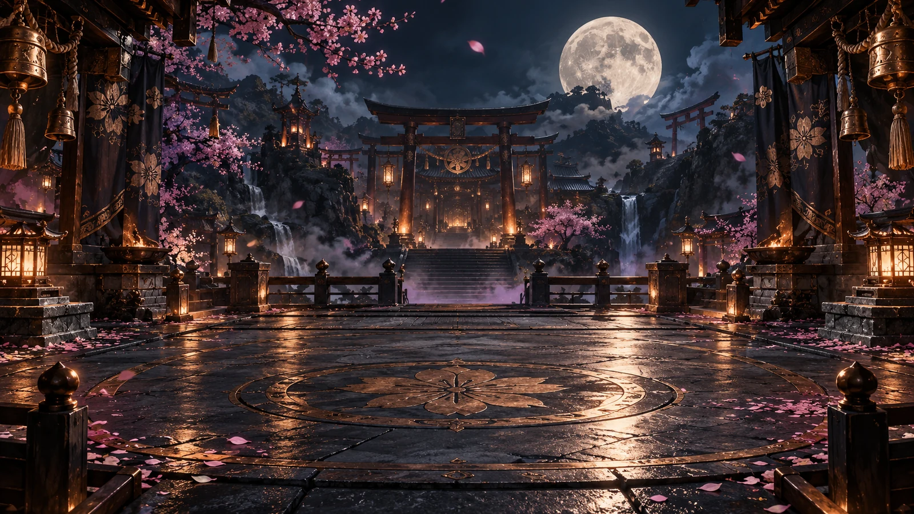
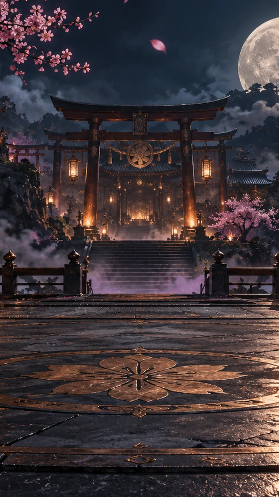
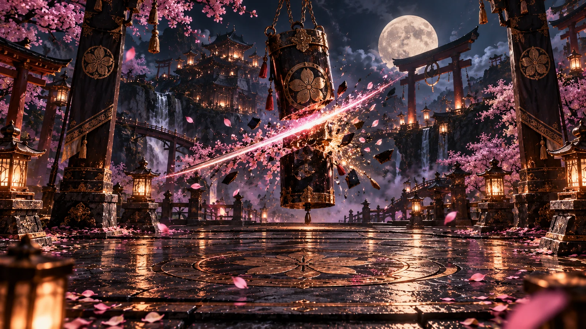
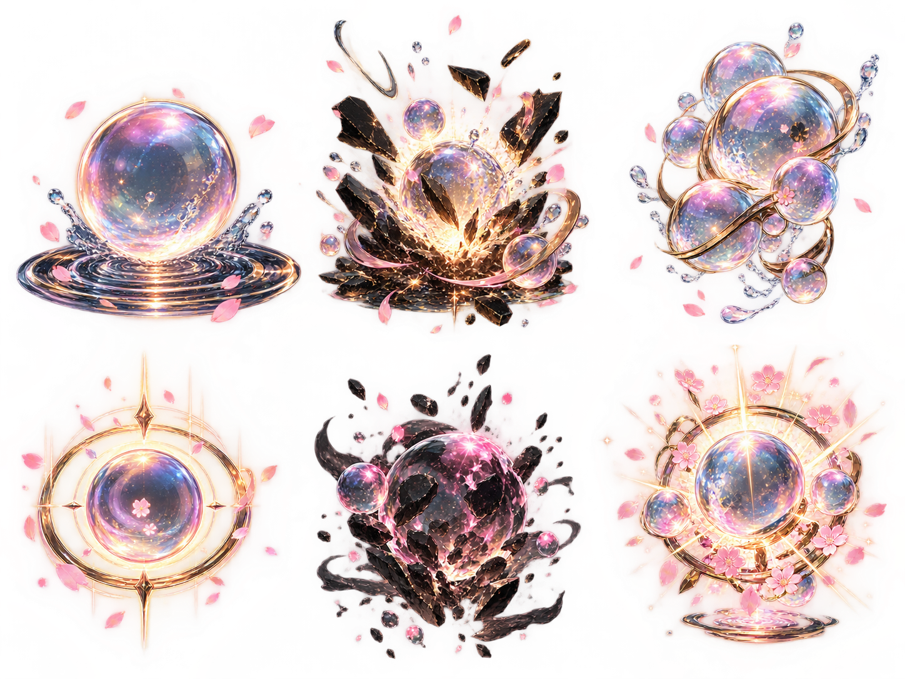
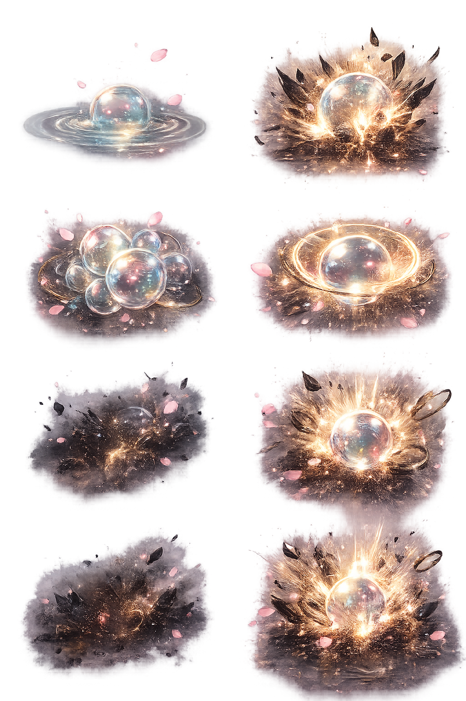

# Game Production Assets V1 — Owner Review

Status: review evidence only. No candidate is promoted by this document.

## Petal Samurai

### Arena crops

| Review item   | Evidence                                                                                           | Current authority                           | Engineering recommendation                                                                                                                           |
| ------------- | -------------------------------------------------------------------------------------------------- | ------------------------------------------- | ---------------------------------------------------------------------------------------------------------------------------------------------------- |
| Desktop arena | `public/assets/games/petal-samurai/environment/petal-samurai-moonlit-shrine-arena-v1-desktop.webp` | Runtime derivative of owner-approved source | Approve. The action circle, shrine gate, moon, waterfalls, and dark outer framing remain legible without competing with the central playfield.       |
| Mobile arena  | `public/assets/games/petal-samurai/environment/petal-samurai-moonlit-shrine-arena-v1-mobile.webp`  | Runtime derivative of owner-approved source | Approve. The torii and action centerline survive the portrait recomposition; the partially cropped moon remains secondary and does not obscure play. |

### Result composition

Evidence: `public/assets/games/petal-samurai/result/petal-samurai-slice-result-scene-candidate-v1.webp`

Recommendation: approve the composition direction. The central split target supplies a distinct
climax while the lower field remains available for the diegetic result record. Keep the current
candidate state until owner approval.

### Slash family

| Effect        | Evidence                                                                          | Recommendation                                                                       |
| ------------- | --------------------------------------------------------------------------------- | ------------------------------------------------------------------------------------ |
| Light         | `public/assets/games/petal-samurai/vfx/petal-samurai-slash-light-v1.webp`         | Approve direction; clearest low-weight judgment cue.                                 |
| Heavy         | `public/assets/games/petal-samurai/vfx/petal-samurai-slash-heavy-v1.webp`         | Revise scale/opacity before approval; current mass can cover targets.                |
| Cross         | `public/assets/games/petal-samurai/vfx/petal-samurai-slash-cross-v1.webp`         | Revise particle density and screen occupancy.                                        |
| Vertical      | `public/assets/games/petal-samurai/vfx/petal-samurai-slash-vertical-v1.webp`      | Revise derivative bounds; a partial neighboring stroke intrudes at the right edge.   |
| Combo ring    | `public/assets/games/petal-samurai/vfx/petal-samurai-slash-combo-ring-v1.webp`    | Approve direction with restrained runtime opacity.                                   |
| Perfect bloom | `public/assets/games/petal-samurai/vfx/petal-samurai-slash-perfect-bloom-v1.webp` | Revise brightness and particle density so rarity reads without obscuring the target. |

Reduced-motion presentation should use one short opacity/scale response without persistent orbit,
shake, or particle continuation.

## Bubble Ragdoll

Shared gameplay context: the existing moonlit arena, physics, rotating objectives, completion,
personal-best, and replay behavior remain unchanged.

| Candidate     | Evidence                                                                                                                           | Finding                                                                                                                          |
| ------------- | ---------------------------------------------------------------------------------------------------------------------------------- | -------------------------------------------------------------------------------------------------------------------------------- |
| Ornate v1     | `docs/design/references/provisional/game-production-assets-v1/bubble-ragdoll/bubble-ragdoll_bubble-vfx-sheet_candidate-v1.png`     | Distinctive but visually dominant; bright halos and edge-fringe risk can overpower bubbles, ragdoll motion, and HUD readability. |
| Restrained v2 | `docs/design/references/provisional/game-production-assets-v1/bubble-ragdoll/bubble-ragdoll_bubble-vfx-sheet_alt_candidate-v2.png` | Better hierarchy and physical impact readability; lower ornament density fits frequent gameplay feedback.                        |

Engineering recommendation: prefer restrained v2 for frequent collision/pop feedback and reserve at
most one ornate v1 treatment for a rare milestone if separately approved. Neither sheet is wired as
an interchangeable runtime family yet, so this is a source-level comparison rather than a claimed
in-game A/B result. Runtime extraction, alpha-edge QA, motion timing, and mobile overlay tests remain
required after owner selection.

## Owner decisions

1. Petal Samurai desktop arena crop: approve or revise.
2. Petal Samurai mobile arena crop: approve or revise.
3. Petal Samurai result scene: approve or reject.
4. Each slash effect: approve or revise.
5. Bubble VFX direction: ornate v1, restrained v2, a bounded split by feedback rarity, or reject.
